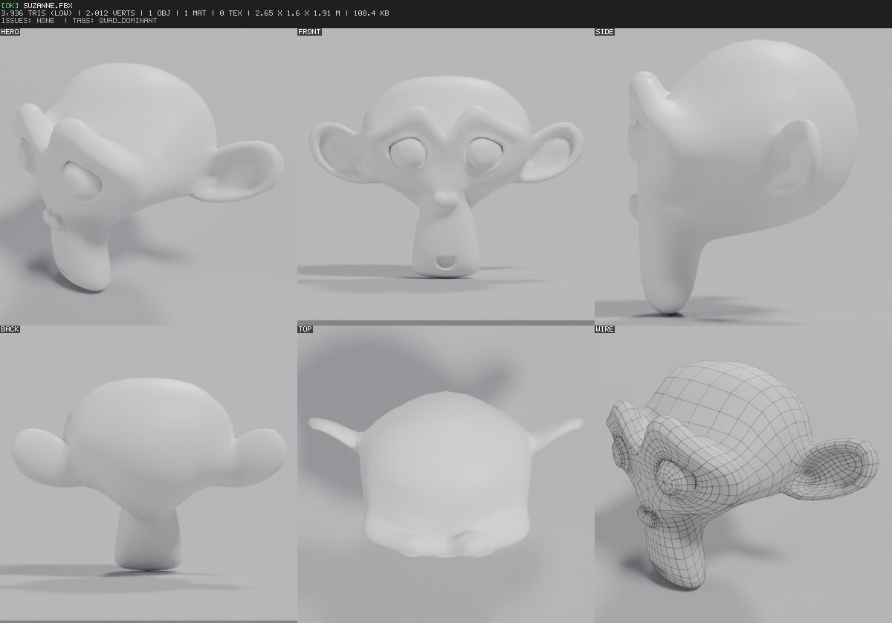
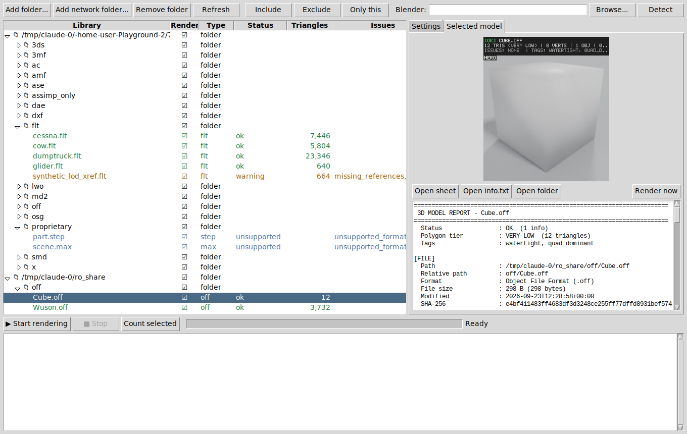
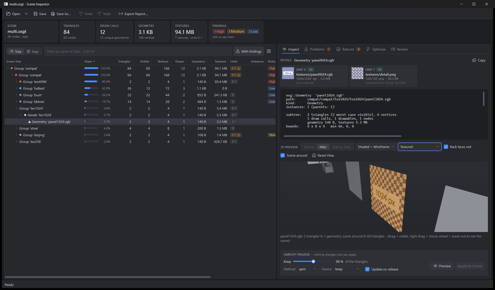
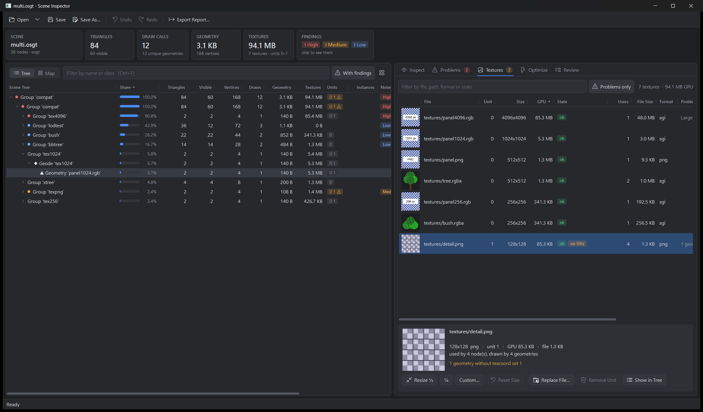
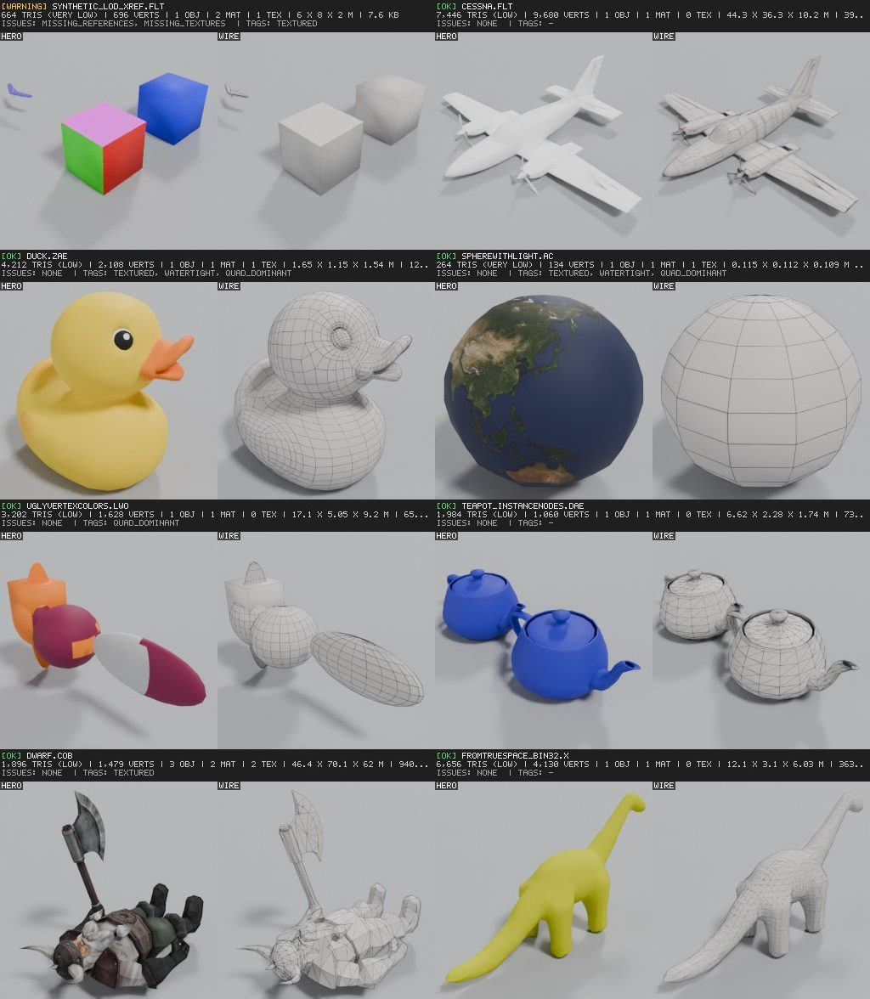

# 3D Database Toolkit

Tools for large 3D model libraries and scene databases. It has two parts:

* **Showcase renderer** (Python + Blender, this page up to [Scene inspector](#scene-inspector-openscenegraph--openflight)):
  catalogues a whole model library with previews, analysis and a SQLite / CSV index.
* **Scene inspector and optimiser** (C# / .NET 8): looks inside OpenSceneGraph and OpenFlight databases, finds what
  makes them heavy and fixes it: mesh simplification, LOD generation, instancing, welding, texture downscaling.

## Showcase renderer

This part renders showcase images and writes an info file for every 3D model in a folder tree. Blender does the work.
It is built for big model libraries where most files have no preview, so you can't tell whether a model works, is broken, or is low or high poly.

For every model it:

1. **Loads** the file in its own background Blender process. More than 80 file endings are recognised; see [Supported formats](#supported-formats), including OpenFlight `.flt`.
2. **Analyses** it: vertex, face and triangle counts, tris/quads/n-gons, watertight check, non-manifold and boundary edges, loose and duplicate geometry, degenerate faces, surface area and volume, size, materials and textures (it also finds missing textures in nearby folders), UV maps, armatures and bones, animation and shape keys.
3. **Adapts the render settings to the model.** The camera is fitted to the geometry. Lights and the floor scale with the model's size. Heavy meshes (over 2M triangles) get fewer samples, and the wireframe is skipped above a face limit. Point clouds are shown as points, and the file's own cameras and lights are hidden.
4. **Works out the orientation**:
   * **Up axis:** a model lying on its side or upside down (common with STL, PLY and OBJ) is detected from its flat base and rotated upright. This is only done automatically for formats without axis information. The other modes are *detect* (all formats) and *importer* (never rotate).
   * **Front and camera angle:** the side that shows the most detail is treated as the front, and the hero shot is a 3/4 view of it.
5. **Renders** a contact sheet (`hero`, `front`, `side`, `back`, `top`, `wire`), with the key facts printed on it (status, triangles, tier, size, issues).
6. **Writes** four files next to the model (or into a mirrored output folder):

| File | Contents |
|---|---|
| `chair.fbx.preview.jpg` | clean hero render (good as a thumbnail) |
| `chair.fbx.showcase.jpg` | contact sheet with all views + info banner |
| `chair.fbx.info.txt` | human-readable report |
| `chair.fbx.info.json` | machine-readable record (fixed schema, see below) |

All records are also collected in **`showcase_index.sqlite`** and **`showcase_index.csv`** in the library root, ready for a database.



Example outputs: [`docs/example_report.txt`](docs/example_report.txt) and [`docs/example_record.json`](docs/example_record.json).

## Installation (works out of the box, only Blender is separate)

1. Install **Blender 4.2 or newer** from [blender.org](https://www.blender.org/download/). The tool finds it on its own, or you can set the path in the GUI.
2. Start the tool by double-clicking its launcher:

| System | Launcher |
|---|---|
| Windows | `Start Toolkit (Windows).bat` |
| macOS | `Start Toolkit (macOS).command` (the first time: right-click → Open) |
| Linux | `./start_toolkit.sh` |

On first start the launcher does the following:
* **Finds Python 3.9+.** On Windows it installs Python with `winget` if none is found; otherwise it opens python.org.
* **Creates a private environment** in `.venv` next to the tool. Nothing is installed system-wide.
* **Installs the optional packages** from `requirements.txt`:
  * Pillow: previews inside the GUI.
  * numpy + assimp-py: about 40 extra rare formats, with no separate tools needed. numpy also powers the [scene inspector](#scene-inspector-openscenegraph--openflight).

  Each package is installed on its own. If one has no build for your Python version, it is skipped and the tool still works.
* **Checks Tkinter** and tells you how to add it if it's missing.

Later starts skip all of this. You can check or repair the setup with `python setup_env.py --check` or `python setup_env.py --reinstall`.

**Command line:** `showcase_batch.bat …` (Windows) or `./showcase_batch.sh …` (Linux/macOS). These use the same environment.

The tool itself only needs the Python standard library. Everything else is optional, and Blender brings its own Python and numpy for the rendering side.

## GUI

```
python showcase_gui.py
```



1. **Add folder…** adds one or more library roots.
2. Click the **Render** column (☑ / ☐ / ▣ = partly) to include or exclude folders and single models. You can also press Space, use the right-click menu, or the *Include / Exclude / Only this* buttons.
   Excluding a folder excludes everything in it, and you can re-include single items inside it. A file named `.noshowcase` in a folder excludes that folder too.
3. Choose a **preset** (`quick`, `standard` or `high`) or set things yourself, then press **Start rendering**.
4. Click any model to see its contact sheet and report. **Render now** re-renders only the selected items.

The tree shows each model's status (ok / warning / broken / error), triangle count and issues.
Everything you set (folders, include/exclude marks, settings) is remembered, and you can save it as a job file (*File → Save job*).
Unchanged models are skipped, so you can stop at any time and continue later.

## Network folders (NAS, SMB/Windows shares, NFS, mapped drives)

Use **Add network folder…** in the GUI, or pass the path to the command line. Any of these forms work:

```
\\server\share\models          Windows UNC path
Z:\models                     mapped network drive
/Volumes/share/models         macOS (connect the share in Finder first)
/mnt/nas/models               Linux mount (also GNOME/KDE smb:// mounts)
smb://server/share/models     resolved to where that share is mounted
```

What the tool does differently for network folders:
* **Read-only shares:** results are written to a local fallback folder instead (default `~/3DDatabaseToolkit/output/<share>/…`, set in Settings → Output). The folder structure is kept, and the GUI and skip logic find the results there.
* **SQLite index on a share:** it is built in a local working copy and copied to the share every 200 models and at the end. SQLite's file locking is not reliable over SMB/NFS.
* **Flaky connections:**
  * file reads, writes and hashing are retried;
  * if the share disconnects, the tool waits up to a minute;
  * if it's still gone, its remaining models are marked `error` (`source_unavailable`) and picked up automatically on the next run.
* **Folders you can't read** (no permission, offline) are listed in the log and skipped.
* **Timestamps:** network file systems store times with ~2 s precision, so unchanged files are still recognised and skipped.
* **Slow shares:** the GUI tree loads folders in the background, so the window never freezes. Timeouts are 1.5× longer for files on a share.

Tip: when several computers render the same share, give each one its own folder selection, or set `--output-dir` to a local folder per machine.

## Command line

```
python showcase_batch.py D:/Models                          # everything, results next to models
python showcase_batch.py D:/Models --preset quick --jobs 4   # fast triage, 4 Blender processes
python showcase_batch.py D:/Models --exclude D:/Models/old --include D:/Models/old/keep.fbx
python showcase_batch.py D:/Models --output-dir D:/Showcase # don't write into the library
python showcase_batch.py --job library.showcase-job.json    # job saved from the GUI
python showcase_batch.py D:/Models --list                   # just list the selected files
python showcase_batch.py D:/Models --reindex                # rebuild SQLite/CSV from .info.json
python showcase_batch.py --help
```

The tool finds Blender on its own: it checks `BLENDER_PATH`, then `PATH`, then the usual install folders. You can also pass `--blender`.
`--blender` can also point to a Python interpreter that has `pip install bpy`, which is handy on render servers.

## Scene inspector (OpenSceneGraph / OpenFlight)

A separate tool for looking *inside* one scene: which nodes, geometries and textures make it big, and what can be
done about it. It reads `.osgt`, `.osg` (legacy) and `.flt` itself; `.osgb`, `.ive`, `.osgx` and other formats
OpenSceneGraph understands work when `osgconv` is installed (it converts them on the fly). Blender is not needed.
It is written in C# / .NET 8 (Windows window, cross-platform command line), see [C# version](#c-version); the
older Python inspector has been removed.



Open it from the GUI (**Tools → Scene inspector**, or right-click a model → **Inspect scene**), with
**`Scene Inspector (C#).bat`**, or on the command line (`sceneinspect`, see [C# version](#c-version)):

```
sceneinspect city.osgt                     # text report: tree, hotspots, findings
sceneinspect city.osgt --json report.json  # everything as JSON
sceneinspect city.flt --optimize safe -o city.optimized.osgt
sceneinspect city.flt --optimize aggressive --in-place  # overwrite city.flt and its changed .flt files, backup first
sceneinspect city.flt --optimize safe -o city_copy/       # self-contained copy of the whole database in a folder
sceneinspect city.osgt --optimize weld,share_duplicates,simplify --set simplify.ratio=0.3
sceneinspect --list-passes
sceneinspect --list-profiles                # built-in profiles and your own (%APPDATA%\SceneInspector\profiles)
sceneinspect city.flt --profile "Tree, aerial" -o city.trees.osgt     # a profile's passes and settings
sceneinspect city.osgt --optimize replace_cards --set replace_cards.layout=aerial
```

`--profile NAME|PATH` (a profile name, or the path of a profile JSON file) can be repeated; profiles and `--set` apply in
the order given, so a later `--set` overrides the profile. A profile alone runs its passes; with `--optimize` both lists
run. With `--profile` the run record starts with `profile=name@version`
(in the window only the Optimize tab's own *Run* writes it).

### Scene tree

**The scene tree** shows every node with the cost of its whole subtree, biggest first. Click a column header to
sort by that column (again to reverse; *Scene tree* sorts by name, *Notes* by the worst finding); children are sorted
among their siblings, so the hierarchy stays, and open branches stay open:

| Column | Meaning |
|---|---|
| Share | bar + the larger of the node's share of all triangles and of all memory |
| Triangles | drawn triangles; a shared (instanced) subtree counts once per use, every LOD level counts |
| Visible | worst case visible triangles: only the most detailed LOD level, only enabled switch children, nothing under node mask 0 |
| Vertices, Draws | vertices and draw calls (one per primitive set, one per strip of a `DrawArrayLengths`) |
| Geometry, Textures | memory; shared geometry and textures count once. Textures: GPU size incl. mipmaps, read from the image header |
| Inst. | how often the node is drawn (instancing) |

External references (ProxyNode, FLT external references) are loaded and shown in the tree; PagedLOD files only
when *Load PagedLOD children* is ticked, because paged databases can have thousands of them. The optimiser works
inside external files too (untick *include external files* on the Optimize tab, or use `--keep-externals`, to
change only the main file).

With *Fold chains* ticked (default, above the tree) a chain of nodes with one child each (groups, transforms, objects,
external references; never geometry, a LOD, a switch or a hidden node, which keep their own rows with their ranges and
state) is one row, written `a › b › c`; the row carries the cost and the worst finding of the whole chain, and its notes
show that finding and how many more the chain has ("(+2)"). Untick it to see every node on its own; branches that were open stay open. Hover a
row for its full path; long names are cut in the middle, so the first level that tells two tiles apart (the tile) and the
object stay readable.

**The selection view** under the tree (*SELECTED*, 220 px tall, always on screen whatever tab is active) shows the
selected nodes as a picture, textured, with the selection in orange. *Scene around* draws the rest of the scene in grey
around it, so you see where the object sits; several selected nodes are drawn where they are in the scene. The header
names the selection. It draws a quarter of the triangles the Inspect preview does and has no mouse camera:
double-click it to open the same node in the Inspect preview. Collapse it with its arrow; both its state and *Scene
around* are remembered.

### Panels and layout

Every panel (Tree, Inspect, Problems, Textures, Optimize, Review) can leave the window: **View → … in its own window**, or the pop-out button on a tab, puts it into a window of its own (another place on the screen, a second monitor); closing that window docks it back. The layout (which panels are out, where their windows are, the selection view, the main window's position, size and maximised state, and the tree/side split) is saved in `%LOCALAPPDATA%\SceneInspector\layout.json` when you close the inspector and after every pop-out or dock, and read on start; a file that cannot be read is ignored and the default layout is used. **View → Reset Layout** restores the default. **F1** (or the **?** button) opens this README at the section of the panel you are in.

The window has the scene on the left (**Tree** or **Map**) and five tabs on the right (Ctrl+1..5): **Inspect**,
**Problems** (findings, hotspots and similar objects), **Textures**, **Optimize** and **Review**. Tiles at the top show triangles, draw
calls, geometry and texture memory, texture units and findings, with the change since the file was opened.
### Inspect

The **Inspect** tab shows everything about the selected node: matrix, LOD ranges, arrays with types and sizes,
primitive sets, state set, a card per texture unit that applies (own or inherited, with thumbnail, size and state,
"no UVs" when the geometry lacks the unit's texture coordinates), its findings, and the 3D preview below. The tree's
**Units** column lists the texture units drawn at / below a node (orange: an image or the texture coordinates of a unit are missing).

**Trying a simplification.** Under the preview, the *Simplify preview* strip simplifies a copy of the selected node
and shows it side by side with the original; nothing changes in the scene until you press **Apply to Scene**. The
strip and the *simplify* pass on the Optimize tab edit one shared set of settings: change a value in one and the other
shows it.

* **Within** (default) or **Keep %**. *Within* sets the largest distance the new surface may be from the original; the
  number of triangles is the result. Type `2 cm`, `5 mm`, `0.3` (a bare number is metres), `0.5 %` or `0.5 % of size`
  (a comma works as the decimal separator), or use the slider (0.1 to 5 % of size). A *% of size* is a percentage of
  each part's own size (the diagonal of its bounding box), but never more than that percentage of the diagonal of
  everything below the selected node; the box shows that upper limit in metres ("up to 1.41 m"). So a 1 m prop on a
  283 m tile keeps to 5 mm at 0.5 %, not to the tile's 1.41 m.
  *Keep %* keeps that share of the triangles instead, whatever the error. *Fast, rough* has no distance limit and always
  keeps a share. Distances are in metres: OpenFlight files are converted to metres on load and OSG files are assumed to
  be in metres, and the strip says so when the file stores another unit (for example "metres (the file stores feet;
  converted on load)"). Under a scaled or mirrored transform the distance still holds in the world, not in the node's
  own units.
* The **strategy** decides what may happen to texture seams and hard edges, see [Simplify strategies](#simplify-strategies).
  *Advanced* holds tile edges, separate parts, the hard-edge angle, the size of a new texture and *Keep roads and
  decals on the ground* (below).
* The **Simplifier** next to the strategy (also on the Optimize tab) picks the engine: *Standard* (default) or
  *meshoptimizer*. With meshoptimizer every vertex that stays keeps its exact position and UVs (the result is a subset
  of the original vertices, nothing is refitted), with open borders *match* or *lock* tile edges are kept as they are
  (it cannot thin them the way the standard *match* does; the pass says "meshoptimizer: tile edges kept (match needs
  the standard simplifier)"; with *slide* they may collapse along themselves), and
  separate parts are never merged. *Within* works the same way: the result is measured and tightened until it holds,
  because meshoptimizer's own error number is an estimate, not a bound. *New texture* always uses the standard
  simplifier. *Advanced* adds **Drop tiny separate parts (meshoptimizer)**: small loose pieces that fit within the
  error limit disappear (`simplify.prune`). Prune never removes parts that touch a locked tile edge or protected
  terrain under roads (the pass falls back to no pruning for that geometry). What each strategy means with it is under
  [Simplify strategies](#simplify-strategies). Without `meshoptimizer.dll` next to the program the pass does nothing
  and says "meshoptimizer is not available on this computer (meshoptimizer.dll not found next to the program)".
* **Roads and decals stay on the ground** (overlay protection, on by default, *Advanced*). A road or decal draped a
  few centimetres above a terrain tile would float or sink where the tile under it is simplified. So the tile keeps
  every vertex under such an overlay (its footprint plus one tile edge around it) and is simplified only elsewhere;
  the verdict then ends with "overlay contact kept", and the pass message says "overlay contact kept on 1 geometry".
  An overlay is a separate geometry whose faces lie 0 to 5 cm above the tile (down to 5 mm below it) over at least
  80 % of their area; a tree or a house standing on the tile is not one. An overlay that covers 90 % or more of a
  tile counts as a copy of its surface (a duplicate tile on the same spot) and is not protected; the message says
  "overlay covering the tile treated as a copy, not protected". The preview, *Apply* and the pass look for overlays
  among every geometry of the scene whose box overlaps the tile (also inside the selection). Without an overlay nothing
  changes. *Fast, rough* cannot keep vertices: it says "Fast, rough cannot keep terrain under roads" when there is an
  overlay. The protection is on by default also for the command line pass (`simplify.protect_overlays`, set it to
  false for the old behaviour).
* The line under the preview gives the damage verdict (OK, CHECK, LIKELY DAMAGED) and the reasons; what it measures
  and where the limits are is under [Review](#review) → *Damage check*. **Apply to Scene**
  runs the pass with exactly the settings of the preview on exactly the geometries the preview simplified (a coarser
  LOD level, a switched-off child or a hidden part that the preview did not show stays as it is), so you get the
  triangles you saw. It is enabled only while the
  preview matches the current settings and removed triangles; after a change of settings it asks for a new preview.
  Afterwards the side-by-side picture and the verdict stay and the status line reads, for example, "Applied: 1,800 → 899
  triangles, OK" (with the node totals and what was removed) until the selection changes. Undo with Ctrl+Z.
* **If nothing was simplified** the info line says why ("Nothing simplified: every collapse would exceed the max
  deviation") and a button under the verdict offers the next setting: with *Keep textures exact*
  `Try “Let edges merge”`; with *Within* the next larger distance (0.001, 0.002, 0.005, 0.01, 0.02, 0.05, 0.1, 0.2, 0.5, 1 m,
  or 0.1, 0.2, 0.5, 1, 2, 5 % of size), for example `Try “Within 5 cm”`; with *Let edges merge* and nothing left to
  widen `Try “New texture”`. One click changes the settings (in both editors) and runs the preview again. Parts that are
  too small to simplify (fewer than 4 triangles) give no suggestion.

### Textures



The **Textures** tab lists every texture with a thumbnail, unit, size, GPU memory, state (ok / missing / embedded /
baked / resize → WxH / no UVs), users and problems; filter it, show only problems, sort by any column. Double click
(or Enter) selects the nodes using it. **Resize** (½, ¼, custom; written when saving, the original file is untouched),
**Replace File…** and **Remove Unit** (state sets made by the optimiser only) are all undoable.
Textures are grouped by file: one row per image file, with "used in N files" (the database files that draw it) and the
number of distinct nodes under *Users*, even when many texture entries point at the same file. After a run the tree keeps
its order, and the rows the run changed get a dot, so you find what was touched without sorting again.

### Problems

The **Similar** view (Problems tab) finds copies of the same object under different nodes, matched by **name**
(case, extension and trailing numbers ignored), **size**, **topology** and optionally **texture**. Each group shows
its copies, triangles each and in total, its texture / material variants ("2: 18× tree.png, 6× tree_autumn.png") and
how closely the copies match: *instanced* (already shared), *identical* (same vertex data), *rigid* (same shape,
vertices pre-transformed) or *similar* (criteria only). For the selected groups, **Select All in Tree**, **Billboard
All**, **Cross Cards All**, **Cards All…** and **Proxy All** (copies that look the same share one atlas, one per variant) and **Make
Instances** work on every copy at once, with undo and Review. Right-click a node in the tree → **Select Similar
Objects** to jump to its group; the Hotspots list marks geometry that has copies ("×24 similar"). Cards are suggested
only for foliage-like groups: the tallest copy is under 40 m and the textures are see-through (texels with alpha, also inside
external files; an opaque RGBA texture does not count) or a name says plant (tree, bush, palm, hedge, grass … at the start
of the name or after `_`, so `oak_tree` counts and `street_lamp` does not); for other groups the finding suggests *Make instances* or *Simplify* and
says why cards are not offered. *Cards All…* (also in the menu) first asks for a layout from the list under [Card layouts](#card-layouts-replace_cards) and then puts those cards on all similar objects; *Billboard All* and *Cross Cards All* work as before. *Billboard All*, *Cross Cards All*, *Cards All…* and *Proxy All* always ask for a confirmation that names
the consequence (the objects are replaced; undo with Ctrl+Z), and *Select All in Tree* is the accent button.

For big databases (tens of thousands of nodes, thousands of findings):
* the **Map** tab draws the scene as a treemap: every node is a box whose area is its cost (*size by* triangles,
  visible triangles, draw calls, geometry / texture memory, memory or vertices) and whose colour is the worst finding at
  or below it (red high, orange medium, blue low, grey none). Hover shows the numbers, click selects the node in the
  tree, double click zooms in, *Up* / *Whole scene* zoom out. Where the triangles or the texture memory sit is visible
  at a glance;
* the findings (**Problems** tab) can be filtered by type (each type with its count, worst severity and total saving) and by
  severity.

**Findings** (with severity, estimated saving and a one-click **Fix this**):

| Finding | Fix |
|---|---|
| heavy geometry, small objects with far too many triangles (compared with the rest of the scene) | simplify / generate LOD |
| identical geometry stored several times, the same image loaded by several textures, duplicate state sets | share duplicates (instancing) |
| duplicate vertices, unindexed triangle soups (`DrawArrays`), degenerate triangles, unused vertices, 32-bit indices for small meshes | merge vertices / clean / triangle lists |
| many small drawables with the same state, geometries with many primitive sets / strips | merge geometries / triangle lists |
| far-from-origin vertex coordinates (float precision jitter), double precision arrays | re-center / float arrays |
| large, non power-of-two, embedded or missing textures | downscale textures |
| hidden subtrees (node mask 0), LODs whose levels barely differ, empty / redundant nodes, deep hierarchies, missing external files | remove hidden / empty / redundant |

### Optimize

The line under *Apply to* names what the passes will touch: *Whole scene*, *Nothing selected*, or the selection with its
kind and file (`'terrain' (Geode) in tile_0_0.flt`), plus how many places and files draw it when it is shared; several nodes
name the files they live in (`2 nodes: 'terrain', 'road' in 2 file(s)`). *Run* repeats the name ("Run 7 passes on
'terrain' in tile_0_0.flt, 1 place(s)"). When a selected node is shared (drawn at several places or its file used from
several files), *Run* asks "Run on a shared selection?" first, because the passes change every place that draws it; the
result can be checked in Review and undone with Ctrl+Z.

The *simplify* pass shows the same settings editor as the Inspect preview strip (*Within* / *Keep %*, strategy, *Advanced*),
and the two stay in step. On the CLI (`--optimize simplify`) the pass still keeps `simplify.ratio` of the triangles
without `simplify.target`, with two differences from round 1: terrain under roads and decals is now protected by
default (`--set simplify.protect_overlays=false` for the old behaviour), and `simplify.max_error` is in metres (scene
units after load), converted for each geometry into its local units through its matrices, so it holds in the world.
`simplify.max_error_pct` (with `simplify.target=within`) is a share of each part's own size, at most that share of the
selected node's size; given together with it, `simplify.max_error` is that upper limit in metres.

Profiles are saved settings for a kind of object. The preset box lists the presets (*Safe*, *Aggressive*, *LOD*, *None*,
*Custom*), then a separator; after it come the eight built-in profiles (*Tree, ground level*, *Tree, aerial*, *Tree, far / forest*, *Clutter*, *Tree LOD chain*,
*Building far*, *Building box*, *Vehicle far*) and then your
own. Choosing one ticks its passes with all their settings and shows a hint under the box on what to select first
("Select the trees; copies of one tree share one atlas"). Changing a setting afterwards turns the entry into
*Custom (from ...)*; the profile itself stays unchanged. **Save as profile…** stores the ticked passes with every setting
under a name (the name of a built-in profile or a preset is refused); **Delete profile** removes one of your own
(built-ins cannot be deleted); **Open profiles folder** opens `%APPDATA%\SceneInspector\profiles\`, where each
profile is a JSON file. The start of the run record reads `profile=name@version` followed by the settings that ran, but
only for the Optimize tab's own *Run* (not for *Cards All…*, Similar or Try). Under `replace_cards` a **Layout** row
shows the chosen layout, a diagram of its planes and a count line (triangles and pictures). On the command line see
[Scene inspector](#scene-inspector-openscenegraph--openflight) (`--profile`).

### Optimisation passes

**Optimisation passes** (tab *Optimize*, right-click in the tree for the selection, or `--optimize`):

| Pass | What it does |
|---|---|
| `remove_empty`, `remove_redundant`, `remove_hidden` | delete empty nodes, collapse single-child groups and identity transforms, drop node-mask-0 subtrees |
| `remove_occluded` | for the selected objects: delete triangles never visible from outside (vehicle interiors, engines, insides of double walls). The object is rendered from 162 directions around it; glass and cut-out textures are see-through, neighbours of visible triangles stay, geometry shared with other places is skipped, moving parts (switches, DOFs, animations) are left as they are and hide nothing. Select single objects (a vehicle, a building), not the ground they stand on. `ground = above` renders only from above the horizon and also deletes down-facing triangles (for objects that stand on the ground; wrong for aircraft and bridges, which are seen from below). Command line: `--select NAME[,NAME]` |
| `replace_cards` | for the selected trees / bushes: render the object from several sides into one alpha texture and put vertical cards in its place (same position and size). `crossed` (default): 4 fixed planes through the centre, front and back with their own picture, back faces culled, alpha test; works in every renderer. `billboard`: one card that turns around the up axis to the viewer (`osg::Billboard` AXIAL_ROT; in OpenFlight an axial billboard face). Select only the foliage to keep a real trunk. Z is up. The 3D preview draws billboards as stored (facing -y), not turned to the camera. *share* (default on): identical / rigid copies with the same textures are baked once and the other copies reuse the cards under a transform (billboards: at the copy's position, its turn about Z does not matter). More card shapes and coverage mips: see [Card layouts](#card-layouts-replace_cards). |
| `replace_proxy` | for the selected objects (buildings, vehicles seen from far): one closed, simplified hull with one baked texture at the same place and size (*ratio* of the triangles, texture size, voxel resolution); insides disappear. *share* as for `replace_cards`. More under [Textured proxies](#textured-proxies-replace_proxy) below |
| `share_duplicates` | instancing: identical geometries, geodes, state sets and textures become one shared object |
| `make_instances` | copies that differ only by placement (same vertex data, or the same shape turned / moved with pre-transformed vertices) keep one geometry per texture variant; the other copies become a MatrixTransform around the shared one. OpenFlight: each shared object is written once as an instance definition, every copy as an instance reference under a group with its matrix |
| `weld` | merge identical vertices (optional position tolerance), turn triangle soups into indexed lists |
| `clean` | remove degenerate and duplicated triangles and unused vertices |
| `triangulate` | strips / fans / quads / polygons / `DrawArrayLengths` → one indexed triangle list (one draw call), 16-bit indices where possible |
| `merge_geometries` | merge small sibling drawables with the same state set into one geometry (fewer draw calls) |
| `flatten_transforms` | bake static transforms into unshared geometry |
| `compact_arrays`, `float_arrays` | per-vertex colour arrays with one colour → one overall colour; double → float arrays |
| `recenter` | move far-away geometry to its local origin and put the offset into a (double precision) MatrixTransform |
| `vertex_cache` | Tipsify triangle reordering + vertex fetch order (lower ACMR, faster drawing) |
| `simplify` | mesh decimation: quadric edge collapse with attribute quadrics, or the fast R-Simp method, see [Simplification and LOD](#simplification-and-lod-c-only). *UV / normal seams*: `keep` lets seams slide only along themselves, so the mesh cannot tear; `permissive` lets hard edges and flat shading collapse as well (vehicles and buildings are full of them, which is what stops `keep` early) and recomputes the normals afterwards, hard above *crease* degrees (default 40); UV seams still only slide, so textures stay; `rebake` simplifies the shape only, without the 2 % safety limit (the target count decides), gives the result its own UV layout and bakes texture unit 0 and the vertex colours onto a new texture (*rebake texture*, default 512 px; saved in the format of the texture it was baked from, see *Texture formats* below; the material is kept); `ignore` welds by position first: the shape is simplified, textures may smear |
| `generate_lod` | wrap heavy geometry in an `osg::LOD` with simplified levels (default 50 / 25 / 12 / 6 %). *Switch distances* `error` (default): each level's largest deviation `e` is measured and the level switches in at `d = e × screen height / (2 tan(fov/2) × pixels)` (defaults 1080 px, 45°, 1 px), so a switch changes the picture by at most about one pixel (no popping); levels that would never be seen are dropped. `fixed`: multiples of the bounding radius. *Farthest level* `cards` puts cards (see `replace_cards`) at the far end, in the layout of `far_layout` (default `crossed4`, the cross cards of before; any named layout of [Card layouts](#card-layouts-replace_cards)); `proxy` makes the far level a textured proxy with the options of `replace_proxy` (`proxy_parts`, `proxy_from`, `proxy_ground`, `proxy_normals`, see [Textured proxies](#textured-proxies-replace_proxy)). New OpenFlight LOD records get a transition range of 10 % of the switch distance (used by image generators that blend; plain OSG ignores it) |
| `downscale_textures` | halve textures above a size limit; the copies are written next to the saved scene (`<scene>_textures/`) in the same file type, originals stay untouched; a type that cannot be scaled here (e.g. `.dds`) keeps the original with a save warning; class maps keep their size unless `resize_class_maps` (then nearest-neighbour). `keep_coverage` (default off): cut-out textures (leaves) keep their leaf area (the share of see-through texels) when shrunk, so trees do not thin out |

Presets: **safe** (does not change the look), **aggressive** (adds simplification, re-centering, texture
downscaling, ...), **lod**. Without a selection, `simplify` and `generate_lod` only touch geometries above their
size limit (10,000 / 20,000 triangles); the log says so when nothing reaches it. With nodes selected the limit
does not apply. OpenFlight groups and objects are treated like plain OSG groups (they are written as such), and
automatic FLT names like `g12` or `o145` do not count as "named nodes". Passes with a chip in the window need a check:
*changes look* (orange: the picture differs, e.g. cards, proxies, simplify) or *changes structure* (grey: the graph is
rearranged but every triangle stays, i.e. `remove_redundant`, `make_instances`, `flatten_transforms`, `recenter`). The
legend shows both. The Problems tab badge counts high + medium + low findings; its tooltip says "N findings (groups), M objects".

### Card layouts (`replace_cards`)

Every key here is optional. Untouched, `replace_cards` builds the same cards and the same files as before
(`mode = crossed`, 4 `planes`, or `billboard`); the choices below sit next to them.

* **`layout`** picks a named set of cards and fills in the keys below (the editor shows the filled values; changing one
  turns the layout into *custom (from ...)*). `custom` (default) uses the keys as set. `mode` also takes `layered`
  (vertical planes plus horizontal ones for crowns and ground cover) and `box` (textured faces on the bounding box,
  facing outward, for far buildings; not for trees).
* **Horizontal planes** (`layered`, or `billboard` with crown planes): `horizontal` is their number (0-3), `heights`
  where they sit (a share of the object height, or `auto`), `slab` what they show (`full`: the whole top view on
  each plane; `slice`: only the geometry between the planes), `faces` which pictures they get
  (`both`: top and bottom; `top`: top only, so the crown's underside is not seen from below).
* **`back`**: `own` (default) gives the back of a vertical plane its own picture; `mirror` shows the front picture
  mirrored, so the atlas holds half the pictures at the same number of triangles. `box_bottom` also bakes the
  underside of a `box`.
* **`cells`**: `equal` (default) gives every picture the same size, `by_area` more texels to bigger planes.
  **`padding`**: `8` (default) bleeds colour 8 texels into the transparent area, `full` fills the whole cell, so
  filtering and mipmaps show no dark fringe. Class maps (`*_Classes.png`) stay nearest-neighbour throughout.
* The new layouts use a power-of-two atlas; the old `crossed` / `billboard` keep `texture` as given.

| `layout` | triangles | pictures | best for |
|---|---|---|---|
| `billboard` | 2 | 1 | far trees, forest rows (today's *billboard*) |
| `crossed4` | 16 | 8 | all-round; today's *crossed* default |
| `cross2` | 8 | 4 | bushes and clutter (just two planes) |
| `star3` | 12 | 6 | single trees; no direction where the tree is edge-on |
| `pixyz` | 12 | 6 | two vertical planes plus one crown plane (the Pixyz billboard arrangement) |
| `ground` | 16 | 8 | trees seen from roads and by walkers |
| `aerial` | 18 | 9 | helicopter / UAV views that look down at crowns |
| `box` | 10 (12 with `box_bottom`) | 5 (6) | far buildings that are small on screen (below about 30 px) |

Pictures are atlas cells. `back = mirror` halves them (the triangles stay).

**Coverage mips** (`alpha_mips`): `renderer` (default) leaves the mipmaps to the renderer, which thins the leaves in the
distance. `coverage` writes mipmaps that keep the leaf area per picture. They exist only when the atlas is written as
`.dds`, which happens when the source textures are `.dds`; for other file types the setting changes nothing.
`downscale_textures.keep_coverage` does the same for shrunken cut-out textures.

In Review each card geometry gets a verdict: **OK** when at least 80 % of the leaf area remains at 1/8 size and no
class map had to be filled; otherwise **Check** with the reason (for example "leaf area at distance 62 %: renderer mips
will thin the leaves; use .dds with keep_coverage", "write .dds with coverage mips, or use more texture", "class map: 3
parts filled with class 0", or "leaf area not measured": never OK on something not measured).

### Textured proxies (`replace_proxy`)

Defaults give one hull for the whole object that keeps `ratio` (5 %) of the triangles. The options below change that.

* **`parts`**: `whole` (default) or `per_part`. With `per_part` the moving parts (DOF, switch) stay under their own nodes and
  are rebuilt in their own frames, so they still move. Small and thin parts (wheels, mirrors, aerials) become convex hulls
  or decimated originals. The whole object gets one atlas. Draw calls: 1 for everything static, 1 per moving part, and
  1 per part that is kept or decimated; the result line names them ("3 parts kept original or decimated, +4 draw calls (...)").
  The line counts drawn geometry only, before and after: of a switch only the child that is on. Animated groups
  (sequences, OpenFlight animated groups) are kept as they are ("lights kept as it is (animated group)").
  Moving parts are recognised from OpenFlight DOF and switch records and from update callbacks; the `.osgt` round trip
  does not keep the `FLT DOF` class, so DOF wheels reloaded from `.osgt` are plain transforms and go into the atlas.
* **`target`**: `keep` (default, a share of the triangles) or `within`. With `within` the proxy stays within `max_error`
  metres (default 0.04), or within `max_error_px` pixels seen from `at_distance` metres (default 100; `max_error_px`
  wins when above 0). 1 px at 100 m is 7.7 cm at 1080 px and 45 degrees (the screen height and field of view of
  `generate_lod`). The deviation is measured both ways on the visible original (proxy to original and original to
  proxy), and with `per_part` the number shown is the maximum over the parts. With `parts = whole` the single hull is
  tightened the same way ("within 4 cm (reached 3.2 cm)"), or the object is left unchanged ("Within 4 cm: could not
  stay within it (best 6.1 cm); left unchanged").
* **Failure per part**: a part whose hull misses the limit becomes a decimated original, and if that fails too, the
  original unchanged. Each such part costs draw calls (see above). The object is left unchanged only when every part fails.
* **`voxels`** (default 128): with `within` it is the upper limit of the hull resolution (longest side). The cell is
  chosen from the error (half of it with `per_part`, finer with each retry); when the limit makes it coarser than
  asked, the message says "hull cells 3.52 cm, coarser than the 1 cm asked". After 120 s on one object no further hull
  is tried; the remaining parts become decimated originals or stay ("time budget reached after 120 s").
* **`ground`**: `full` (default) keeps the underside. `above` renders the views only from above the horizon and drops
  down-facing faces. `cut` removes the underside at the ground plane. `above` and `cut` are for objects standing on
  the ground; wrong for objects seen from below (aircraft, bridges). With `parts = whole` the option does not apply;
  the message says so.
* **`normals`**: `hull` (default) shades from the proxy. `original` transfers the shading of the original surface, with
  edges harder than `crease` degrees (default 45) kept hard, so curved bodies stay round. Works with `whole` too.
* **`generate_lod`**: `proxy_parts`, `proxy_ground` and `proxy_normals` are the same options for the far level.
  `proxy_from` (metres, 0 = off) fixes the far level's error to the pixel error seen from that distance, and is a floor
  for the switching distance: the proxy does not appear closer than that, even if its error would allow it.

```
sceneinspect scene.flt --optimize replace_proxy --set replace_proxy.parts=per_part --set replace_proxy.target=within --set replace_proxy.max_error=0.04 --select car_01
```

### Simplify strategies

The *simplify* pass (and the preview strip) offers one list of strategies, named by what you get; the technical
name is in the tooltip:

| Label | Today | Help line |
|---|---|---|
| Keep textures exact | qem + keep | Only collapses that leave every texture seam and hard edge in place. Safest, reduces least. |
| Let edges merge | qem + permissive | Hard edges may merge (the normals are rebuilt); texture seams still only slide. Textures may shift slightly. |
| New texture | qem + rebake | Simplifies freely, then bakes a new texture from the original. New texture file. |
| Shape only | qem + ignore | Ignores textures. For untextured parts or when the texture will be replaced. |
| Fast, rough | fast (clustering) | Merges nearby vertices by grid cell. Quick, uneven. Good for a first look. |

Tile edges, separate parts, the hard-edge angle, the new texture size and *Keep roads and decals on the ground*
stay under *Advanced*. The *Help* link next
to the strategy opens this section.

With the *meshoptimizer* simplifier (see *Simplifier* above) the strategies mean:

| Label | With meshoptimizer |
|---|---|
| Keep textures exact | Texture seams slide along themselves, hard edges stay. |
| Let edges merge | The same as with Standard: hard edges may merge and the normals are rebuilt; texture seams still only slide. |
| New texture | Uses the standard simplifier (the shape is simplified and baked as above). |
| Shape only | Positions only, textures and normals are ignored. |
| Fast, rough | Grid clustering with locked vertices (meshopt Sloppy), so unlike Standard it can keep terrain under roads and decals. |

### Review

**Debugging changes - see what a pass does before you save.**

* **3D preview** (Inspect tab): the selected node rendered in software (no OpenGL / Blender needed). Drag = rotate,
  right-drag = move, wheel = zoom. *Before*, *After* or *Side by side* with the same camera; shaded, wireframe or
  both; back faces in red (shows flipped faces); colouring by material or as a **deviation heat map**
  (blue = unchanged, red = moved by the set % of the object size or more), **textured** (texture unit 0, cut-outs
  below 50 % alpha; a magenta / black checker marks a missing texture file, plain magenta a texture without UVs;
  images embedded in `.osgt` are shown in their material colour) or **UV checker** (a test grid on the UVs: stretched
  or torn cells show broken UVs, red grows with u and green with v). `sceneinspect render ... --paint textured`
  renders the same on the command line.
  With *whole scene* the selected node is drawn in orange where it sits in the scene (for a shared node or a
  replicated copy: the place clicked in the tree) and the rest of the scene in grey; zoom out to see it. Up to 8 million
  triangles of the selection and 12 million of the scene are drawn.
* **Try simplify** (bottom of the preview, or right-click a node → *Preview / try simplify*): pick the share of
  triangles, the method and the seam handling, and the result is shown next to the original with a damage
  check, without changing the scene. The preview keeps the colouring you picked (textured, material, wireframe …) while
  you try; it no longer jumps back to the heat map. *Apply to scene* runs the real pass on that node.
* **Damage check** for every shape change: surface deviation (sampled two-sided distance to the other surface,
  in % of the object size), new holes (open edges before → after), non-manifold edges, flipped faces, outline
  change, sliver triangles; verdict **OK** (< 0.5 %), **CHECK** (< 2 % or other warnings) or **LIKELY DAMAGED**.
  The check also measures what you see on a textured or assembled object:
  * **Texture shift** ("texture shifted by up to 2.5 texels"): how far the texture moved on the surface, in texels of
    the texture on unit 0 (95th percentile of samples). Up to **1 texel** is OK, above it CHECK, **4 texels** or more
    LIKELY DAMAGED.
  * **Texture stretch** ("texture stretched 1.8×"): the largest change of texture area per surface area of a
    triangle. Up to **1.5×** is OK, above it CHECK. A **flipped UV triangle** (the texture mirrored) is LIKELY DAMAGED.
    Without the texture file (size unknown) no texel numbers are given; the shape verdict stands and the line says so.
    *New texture* and *Shape only* never say OK for the texture: the verdict reads "SHAPE OK", compare the textured view.
  * **Cracks between parts** ("gap or overlap of 3 cm between 'window' and 'body'"): where parts of the selection, or a selected
    part and an unselected neighbour whose box touches it, met before (vertices within 0.01 % of the diagonal), the
    largest new gap. Wider than the *Within* distance (with *Keep %*: 0.5 % of the size) → CHECK.
  * **Almost gone** ("3 parts almost gone: wheel_fl, wheel_fr, antenna"): a part that lost more than **90 %** of its
    area → CHECK, listed once and drawn red in the heat map.
  * **Overlay contact kept**: terrain under roads and decals kept its vertices (see [Inspect](#inspect)); a note, not
    a warning.
* **Review** tab: every geometry the last run created or changed, with pass, triangles / vertices before → after
  and the damage check (worst first); a geometry that lost a texture unit gets a "texture unit 1 dropped" chip and
  counts as *check*. Double click = before / after in the 3D preview and the node in the tree.
* **Undo / Redo** (Ctrl+Z, Ctrl+Y / Ctrl+Shift+Z, 10 levels) for optimisation runs, texture edits, deletes and
  hide / unhide. It restores the scene in place, shared objects stay shared. The **History** list in Review shows
  every step with its triangle / draw call change; click one to undo or redo up to it.
* **Checkpoints**: after every step the changed files of the new state are written to
  `%LOCALAPPDATA%\SceneInspector\checkpoints\<database key>\<session>\` while you look at the result; the next
  command waits for the write ("Writing checkpoint … please wait"). The History list shows the folder and lists the
  checkpoints that are not in memory (steps dropped by the undo cap, earlier sessions on the same database) as grey
  rows; clicking one reloads the database at that state (the title says *state 3: …*, the undo list starts empty).
  **Export States…** (button above the checkpoint line, enabled when the current state has a checkpoint of this session)
  writes the unchanged database and the states that led to the current one, oldest first, to a folder of your choice
  (default: `<database folder>_states` next to the database; never inside the database folder). Steps you undid and
  replaced with another step are left out, so each state builds on the one before; after a Save Over the backup is the
  original. The folder gets `base/` (the unchanged original),
  `state_00_original/`, `state_01_<label>/`, `state_02_<label>/` … (each a complete Save Copy that opens with its
  `master.flt`) and `README.txt` (database, time, then per state the scope, parameters and triangles before → after). Files a
  state did not change are NTFS hard links to the same file in `base/` where the volume allows (else copies), so ten states
  of a big database cost little more than one; the files a state did change are its own. The window then shows how many
  files were linked and copied and where the README is. Load the folders in order in the renderer: the first one that
  fails names the step that broke it.
  Save Over moves the checkpoints along and adds a *before this session's save over* entry for the backup, so the
  old states still load. Checkpoints older than 14 days, and the oldest ones beyond 5 GB in all, are deleted at
  start. The key is the master's path, size and date: a database changed outside the tool starts with no
  checkpoints. Scenes converted with osgconv get `.osgt` checkpoints (not tested yet).
* **Run log** (Review tab): per pass the time it took, what it changed (geometries changed / new, nodes removed,
  triangles / vertices / draw calls / nodes before → after), a reason when it did nothing, and the full traceback
  when a pass fails.

**Big files.** Scenes of a gigabyte and more are read, analysed, optimised and saved in time and memory
that grow linearly with the file: the parser reads line by line and keeps each keyword once, number blocks are
parsed in C, indices are stored once (not as float and int copies), the analysis tracks shared memory without
per-node id sets, the optimiser updates its parent map instead of rebuilding it after every edit, small meshes
are checked in batches of thousands, Python's garbage collector is paused during the heavy steps, freed memory
is handed back to the system and the writer streams to the file. The status bar shows how far reading has got.
Measured on generated test scenes (Linux, one CPU core):

| Scene | Step | Before | Now |
|---|---|---|---|
| 115 MB, 60,000 small meshes in 180,000 nodes | open in the window | 95 s, 1.2 GB | 34 s, 1.2 GB |
| | *safe* preset | not finished after 20 min | 82 s |
| 866 MB, 120,000 meshes, 24 M triangles | load | - | 57 s, 2.7 GB |
| | analyse | - | 53 s |
| | *safe* preset | - | 109 s |
| | save | - | 89 s |
| 270 MB, 400 big meshes | save | 28 s, peak 4.2 GB | 21 s, peak 1.6 GB |

Memory needed is roughly 2-3x the file size for scenes made of big meshes and up to ~6x for files made of
hundreds of thousands of tiny objects (every node and statement is a Python object). Undo keeps 10 levels,
3 for scenes with more than 200,000 nodes.

**Saving** never overwrites the original unless you choose it. There are three ways to save.

*Save Copy to Folder* (Ctrl+Shift+S in the window, `-o FOLDER` on the command line) writes a self-contained copy of the
database into a folder. The folder holds a byte-for-byte mirror of the database folder (without `_backup_*` and
`*_optimized` folders), the changed files written over their mirrored originals, files that came from outside the
database folder in `_external/` (their references point there), baked and downscaled images in `<name>_textures/`, and
`SAVE_MANIFEST.txt`, which lists every file as changed, copied, generated or external. Open `master.flt` in the copy and
everything is found. With *Include unchanged files* off, only the changed, generated and external files are written and the references
stay exactly as in the original (same relative layout), so copy the folder over a copy of the original database before
opening it; the manifest says so. The copy must go outside the database folder (not into it, not into a folder that
contains it) and not into a folder that holds files the database references from outside its folder.

*Save Over Opened Database* (Ctrl+S in the window, `--in-place` on the command line) overwrites the opened files where
they are. First every file it overwrites, and every existing `<name>_textures` folder next to them, is copied to
`<database folder>/_backup_<yyyyMMdd_HHmmss>/` in the same layout; the master is always copied too, so the backup
opens as the database before the save. The window reloads the saved database afterwards. With nothing changed it saves
nothing. Saving over from a restored checkpoint state writes every reference relative to the database folder and first
copies the state's own images (and `.attr` files) from the checkpoint into the database folder. Changed external files in
a format that is not written natively (`.ive`, `.osgb` … read through osgconv) cannot be written in place: Save Over then
refuses before touching anything; use Save Copy to Folder.

`-o FILE` is unchanged: one file is written, and external files that were changed go as optimised copies into
`<output name>_files/`, which the saved scene points at; unchanged external files keep pointing at the originals. With
the command-line option `--overwrite-externals` changed external files are overwritten where they are
instead. `-o` counts as a folder when it is an existing directory, ends with `/` or `\`, or has no extension.
`.osgt` scenes are saved as `.osgt`, legacy `.osg`
scenes as `.osg`, OpenFlight scenes as `.flt` (or `.osgt` if you choose it). OpenFlight is written by patching the
original records: untouched records are copied byte for byte, changed geometry becomes new triangle faces that take
their attributes from the original faces, unused palette vertices are dropped, new LOD levels become LOD records.
Objects and groups the scene shares between several places (`make_instances`, `share_duplicates`) are written once as an
instance definition at the top of the hierarchy and an instance reference at every place (a group with a matrix around it
where it is moved); instance numbers of the source file are kept. Shared single drawables, and shared nodes with external
references or source-file instances below them, are still written once per place.
**Texture formats.** Saving never changes the data format of textures. Baked textures (cards, billboards, proxies,
rebake, LOD far cards / proxy, shared bakes) are written to `<output name>_textures/` in the format of the textures they
were baked from, per texture unit: the extension that covers the most texels among the sources, with the source's
channel layout (grey, grey + alpha, RGB, RGBA) and SGI bytes per channel (8 or 16 bit). The extension changes only when
it cannot hold the result, and the pass message and the save warnings say so:

| source | base unit of cards / billboards (needs alpha) | proxy / rebake base unit | units above 0 (raw) |
| --- | --- | --- | --- |
| `.rgb` / `.rgba` / `.sgi` | same extension, 4 channels (`.rgb` holds them) | same, source channels | same |
| `.bw` / `.int` (grey) | `.inta`; `.rgba` if the bake has colour | same; `.rgb` if the bake has colour | same, 1 channel |
| `.inta` | same; `.rgba` if the bake has colour | same; `.rgb`/`.rgba` if colour | same |
| `.png`, `.tga`, `.tif` | same, with alpha | same, source channels | same |
| `.jpg` / `.jpeg` / `.bmp` / `.gif` | `.png` (`.tga` when the scene's textures are mostly TGA) | same | same |
| `.dds` | `.dds`, uncompressed 32-bit A8R8G8B8 | `.dds`, 24-bit without alpha | same |
| none (material / vertex colours only) | the scene's most used format (by texel area); none: `.rgb` for `.flt`, `.png` otherwise | | |

DDS is written without block compression or mipmaps. JPEG, BMP, TIFF and GIF need the inspector's Windows codecs; the
command line writes them as `.png` (with a warning). Downscaled textures keep their file type and channels. When the
output is `.flt`, every image written next to it (baked or downscaled) whose source image has an OpenFlight
`<image>.attr` file gets a copy of it with the new texel counts and the texture's wrap / filter modes (baked atlases:
clamp); without a source `.attr` none is written, and `.osgt` / `.osg` outputs never get one. Replaced images are referenced
where they are (with their own `.attr`). The default output name keeps the source format (`x.flt` -> `x.optimized.flt`;
a scene read through osgconv is converted back to its own format).


**Infrared (IR) / sensor databases.** Image generators with IR sensor rendering get their IR data in three ways, and
the passes that build new geometry (cards, billboard, proxy, rebake, LOD far cards / proxy, shared bakes per variant)
keep all of them:

- *Texture layers.* Units above 0 (OpenFlight multitexture layers 1-7) are baked into atlases of their own with the
  same layout as the base atlas, sampled raw (no material or vertex colour).
- *Face codes.* OpenFlight faces carry an IR colour code, an IR material code, a surface material code (SMC) and a
  feature ID (face record offsets 12, 36, 32, 34; a mesh record is 4 bytes later from offset 12). New geometry carries
  the source face whose codes cover the largest triangle area (per object, per shared variant), and the `.flt` writer
  puts those codes into its new faces (texture, material, colour, draw type and billboard template are still set for
  the new geometry). New faces also carry the light mode of the source faces they replace, so billboard trees from cards,
  proxies and LOD levels are lit like the originals instead of being fullbright at night. When the parts disagree (trunk and leaves with different IR materials) the pass says
  *IR / material codes differ between parts: used the most common (by area)*. LOD levels and merged geometry keep the
  codes too; `merge_geometries` does not merge faces with different codes; a rewritten geometry whose faces had
  different codes takes the most common one. The Inspect tab lists the codes of a geometry (*OPENFLIGHT FACE CODES*).
  Saving as `.osgt` / `.osg` has no place for them.
- *Companion images.* Files the image generator finds by a naming rule next to a texture instead of a reference in the
  file, e.g. the class map `tree_Classes.png` or the infrared image `tree_ir.rgb` next to `tree.rgb`. The rules
  (`companion_patterns`; default `{stem}_Classes.png; {stem}_ir{ext}; {stem}_IR{ext}`) use `{stem}`, `{ext}` and `{dir}`, may name a sub-folder (`ir/{stem}{ext}`) or their own extension
  (`{stem}_ir.int`) and match case-insensitively. Companions are found when a scene is opened and whenever the rules
  change (inspector: Optimize tab, *COMPANIONS*, kept for the session; command line: `--companions "..."` or
  `--set companion_patterns=...`). The Textures tab shows them as a *Classes* / *IR* chip (column, unit cards, selected-texture
  panel). Baking makes a companion atlas with exactly the layout of the new atlas (sampled raw; alpha from the base
  coverage where the companion's format has alpha) and saving writes it next to the atlas under the same rule
  (`tree_cards.rgb` -> `tree_cards_ir.rgb`), in the companion's own format (TextureFormats rules; the rule's extension
  wins) with a copy of the companion's `.attr` for `.flt` output. Resizing a texture (Textures tab, `downscale_textures`)
  writes its companions at the same size under the same rule; *Replace File* warns when the new file has no companion
  the old one had. A finding (*IR companions on only some parts*) points at objects that mix textures with and
  without a companion.

*Classes (class maps).* A companion matched by the default rule `{stem}_Classes.png` (or any rule whose stem ends in
`_classes`, case ignored) is a class map: every pixel is a class ID, not a colour. It is shown with a *Classes* chip, is
never filtered or blended, and is written as it is. Baked into an atlas (cards, billboard, proxy, rebake, LOD far level) it
is sampled by nearest lookup, so only IDs that exist in the source appear; parts without a class map get `class_fill`
(a class ID 0-255, default 0). A texture on a unit above 0 whose file ends in `_classes` (Trian's *Add Texture Layer*) is
a class map too. Resizing a texture leaves its Classes companion at its own size by default, and `downscale_textures` and
the Textures tab leave a class-map texture itself at its size; tick *Resize class maps too* (Textures tab, or
`resize_class_maps`) to resize them as well, nearest-neighbour, never filtered. A class map that cannot be read (for
example a 16-bit PNG) is not baked and its file stays untouched; the pass message says so (a resize copies it as it is,
with a save warning). The finding *class maps on only some parts* names the objects that mix both. Not covered yet: a
class map on texture unit 0 (a sensor-only database) is still baked with the bilinear colour path.

*Fill.* Where a part has no such layer or companion (a trunk without an IR image under leaves with one), the baked
layer shows `extra_fill` (on `replace_cards`, `replace_proxy`, `simplify` with rebake, `generate_lod` far level):
`white` (default, neutral for modulating maps, but in IR white often means hot), `black`, `luminance` (the grey of
the baked base colour at that texel) or a grey value `0`-`255`. The pass message says which layers needed it.

A scene whose `.flt` files were overwritten must be reloaded before it is saved again. Only what was changed is rewritten; everything the tool does not
understand (callbacks, shaders, user data, unknown classes) is copied unchanged and shared objects stay shared.
With `osgconv` installed you can also save as `.osgb`, `.ive`, or convert between `.osgt` and `.osg`.
Merged drawables lose their own names; use *Keep named nodes* where an application looks nodes up by name.

**Visual quality check.** The passes were checked by rendering original and optimised scenes with the same camera
(Blender Workbench, textured) and comparing the images. LOD levels were rendered from the distance at which OSG
switches to them, on a full-HD frame. Results on the test scenes from `tools/make_test_scenes.py`:

| Scene / view | Variant | Triangles | SSIM | Pixels changed |
|---|---|---|---|---|
| characters, close-up | safe preset | 105k → 105k | 1.000 | 0.00 % |
| | simplify QEM 25 % | → 30k | 0.997 | 0.19 % |
| | simplify QEM 10 % | → 15k | 0.987 | 0.86 % |
| | simplify cluster 10 % | → 15k | 0.927 | 4.1 % |
| city, street level | safe (58 → 20 draw calls) | 92k → 92k | 1.000 | 0.00 % |
| | aggressive (4k texture halved, hydrant simplified) | → 50k | 0.999 | 0.00 % |
| | `.flt` → optimised `.osgt` | 92k → 92k | 1.000 | 0.00 % |
| terrain, close-up | simplify QEM 50 % | 179k → 89k | 0.984 | 0.14 % |
| | simplify QEM 20 % | → 36k | 0.953 | 0.99 % |
| characters, far (LOD 3) | generate LOD | 105k → 25k drawn | 0.999 | 0.05 % |

Use QEM for anything seen up close; clustering is for quick previews. Sheets (render + difference x4):
[characters](docs/quality/characters__monkeyface.jpg), [city](docs/quality/city__street.jpg),
[terrain](docs/quality/terrain__close.jpg), [LOD](docs/quality/characters_lod__far10.jpg).
`tools/make_test_flt.py` writes a large OpenFlight database split into external tile files (the way
modelling tools write them) for testing the optimiser on FLT databases. To repeat the check on your own scenes: `tools/render_variants.py` (needs Blender / bpy) renders a list of variants
with fixed cameras, `tools/compare_renders.py` builds the sheets and the metrics.

## Supported formats

Each file goes through a chain of readers. The first one that works is used, and the report records which one it was. If an earlier reader failed, that failure is noted too.

1. **Blender's importers**, including any add-ons or extensions you have installed.
2. **Built-in readers.** These are pure Python and need nothing extra.
3. **Converters:**
   * **assimp-py:** installed automatically by the launcher.
   * **The [assimp](https://github.com/assimp/assimp) command-line tool and [OpenSceneGraph](https://openscenegraph.github.io/)'s `osgconv`:** only if you install them yourself. The tool finds them on `PATH`, or you can set their paths in the GUI.

| Reader | Endings |
|---|---|
| Blender built-in | `.blend .fbx .obj .gltf .glb .stl .ply .abc .usd .usda .usdc .usdz` |
| Built-in readers | `.flt` (OpenFlight), `.osgt .osg` (OpenSceneGraph text formats), `.dae .zae` (COLLADA, which Blender 5 removed), `.3ds`, `.x` (DirectX text), `.lwo` (LightWave), `.ac .ac3d` (AC3D), `.ase` (3ds Max ASCII), `.off`, `.3mf`, `.amf`, `.smd` (Valve), `.md2` (Quake II), `.vtk` (legacy, ASCII + binary, incl. VTK 5.1 and volume grids), `.dxf` (ASCII + binary; 3D faces, polyface meshes, blocks) |
| Blender add-on, else assimp / assimp-py | `.x3d .wrl .3dm .ms3d .md3 .md5mesh .mdl .mdc .b3d .cob .hmp .ifc .ifczip .iqm .irr .irrmesh .lws .lxo .m3d .ndo .nff .enff .ogex .pmx .pmd .q3o .q3s .sib .ter .vrm .x3db .xgl .zgl`, plus binary `.x` and ASCII `.fbx`. Formats whose axes assimp passes through unchanged (`.cob`, `.xgl`/`.zgl`, `.q3o`/`.q3s`) are turned upright automatically. |
| osgconv | `.osgb .osgx .ive` (and `.osg .osgt` if the built-in reader fails) |
| Listed only, as `unsupported` | `.max .ma .mb .c4d .skp .hip .ztl .zpr .mud .spp .step .stp .iges .igs .jt .sldprt .sldasm .catpart .prt .dwg .u3d .dff .nif .mdx .w3d .mesh` |

The `unsupported` files are proprietary or CAD formats. They still get a `.info.json` and a row in the index, so the database knows they exist, but Blender is never started for them. You can switch this off.



**OpenFlight (`.flt`) details:**
* **Geometry:** faces with the vertex palette and meshes (strips, fans, quad strips, polygons) are read, including the continuation records used for very long lists.
* **Transforms and structure:** matrices, instance definitions and references, and external references are followed. External references are loaded recursively; a missing one is reported as `missing_references`.
* **Colours, textures, units:** colours come from the colour palette or from packed colours. Textures come from the texture palette (SGI `.rgb`/`.rgba`/`.int` load natively). Header units (m, km, ft, in, nmi) are converted.
* **Detail levels and variants:** only the most detailed LOD of each group of sibling LODs is rendered; the others are counted as `lods_hidden`. Switch nodes use their current mask. Animated groups show their first frame.
* **Skipped:** light points, hidden faces and shadow objects.

**OpenSceneGraph text (`.osgt`, legacy `.osg`) details:** read without OpenSceneGraph. MatrixTransform and
PositionAttitudeTransform matrices, shared (instanced) subgraphs, switches, node masks, ProxyNode external files,
vertex colours, materials and textures (also image data embedded in `.osgt` files) are used. Of an LOD only the most
detailed child is rendered (`lods_hidden`); PagedLOD tiles show their own children, the paged files are not loaded.

## Status and issues

| Status | Meaning |
|---|---|
| `ok` | imported and rendered; at most informational notes |
| `warning` | usable, but check it (missing textures, many degenerate faces, non-manifold, extreme scale, …) |
| `broken` | the model itself is unusable (import failed, empty, all vertices in one point, NaN coordinates, Blender crashed) |
| `error` | the tool had a problem (timeout, render failure). Re-running retries these automatically |
| `unsupported` | no reader for this format in your setup (the message says what to install), or a proprietary format |

Poly tiers (by triangles; you can change the limits): `very_low` ≤ 1k, `low` ≤ 10k, `medium` ≤ 100k, `high` ≤ 1M, `very_high`.

**Engines:** `auto` uses EEVEE (fast on a desktop GPU). If EEVEE crashes or fails (e.g. a headless server without a GPU), the model is re-rendered with Cycles and gets an `engine_fallback` note. `cycles` always works and uses the GPU when one is available. `workbench` is the fastest for pure shape checks.

## Record format (`.info.json`)

Top-level keys (`schema_version` 1): `id` (SHA-256 of the file), `status`, `issues[]` (`code`, `severity`, `message`),
`file`, `import`, `scene`, `geometry`, `bounds`, `materials`, `animation`, `orientation`, `classification`
(`poly_tier`, `tags` such as `textured`, `rigged`, `animated`, `watertight`), `render`, `objects_detail[]`, `processed_at`.
`showcase/schema.py` lists every issue code, and `schema.flatten()` defines the flat database row.

Example queries on the index:

```sql
SELECT path, issue_codes FROM models WHERE status = 'broken';
SELECT poly_tier, COUNT(*) FROM models GROUP BY poly_tier;
SELECT path, triangles FROM models WHERE rigged = 1 AND textured = 1 ORDER BY triangles;
SELECT * FROM duplicate_files;                     -- identical files (same SHA-256)
SELECT code, COUNT(*) FROM issues GROUP BY code;   -- most common problems
```

To move to a larger database (Postgres etc.), import the CSV, or load the `record_json` column / the `.info.json` files as JSON documents.

## C# version

`csharp/` holds the scene inspector in C# / .NET 8:

* `SceneInspector.Wpf` - the inspector window (Windows). Start it with **`Scene Inspector (C#).bat`** (builds it on the
  first start; needs the [.NET 8 SDK](https://dotnet.microsoft.com/download/dotnet/8.0)) - drag a scene file onto the
  .bat or open one in the window. Scene tree sorted by cost (multi-selection,
  right-click menu: simplify / LOD / weld / clean / vertex cache / delete / hide), details, findings with one-click
  fixes, hotspots, the optimize tab with all passes and parameters, 3D preview (before / after / side by side,
  deviation heat map, back faces red, try simplify with a damage check and "apply"), the changes list with a quality
  check per geometry, a textures tab (resize / replace / remove unit), undo / redo with a history list, save (Ctrl+S),
  report export. Troubleshooting: if the window stays blank or white (remote desktop, a broken GPU driver), start it
  with `SCENEINSPECTOR_SOFTWARE=1` set to draw without the GPU. Some screen capture tools also catch a GPU-drawn
  window as plain white; that is the capture, not the window.
* `SceneKit` - the core library (cross-platform): reading `.osgt` / `.osg` straight from the file (memory-mapped),
  OpenFlight `.flt` (external references, instances, LODs, switches, matrices, colour / material palettes), other OSG
  formats through osgconv, the analysis with all findings, text / JSON report, writing `.osgt` / `.osg`, all 16
  optimisation passes and presets, simplification and LOD generation (see below), Tipsify, the damage check, change
  tracking, undo snapshots, the software renderer of the 3D preview and texture downscaling (PNG, JPEG, BMP, TIFF, GIF
  with the Windows codecs; SGI `.rgb`, TGA and PNG with its own codecs, also on the command line; baked textures are
  written as SGI, TGA, PNG or uncompressed DDS by its own codecs, JPEG / BMP / TIFF / GIF through the Windows codecs). Textures are read with its
  own codecs plus [StbImageSharp](https://github.com/StbSharp/StbImageSharp) (public domain, pure C#) for JPEG / BMP /
  GIF / PSD; one optional native library (meshoptimizer, MIT, `csharp/SceneKit/native/`) and no AI models are needed.
* `sceneinspect` - the command line, `SceneKit.Tests` - unit tests.

### Simplification and LOD (C# only)

* **`simplify` / `generate_lod`, method `qem`** (`SceneKit/Decimate.cs`): quadric edge collapse with
  * attribute quadrics (Garland & Heckbert 1998, Hoppe 1999): UVs, normals and colours are part of the error; UV /
    normal seams slide along themselves instead of being frozen, so textured meshes reduce much further;
  * merging of nearby separate parts (virtual edges, Liu et al. 2024 / FA-QEM 2026), for assembled models;
  * a least-squares refit of the result to the original surface (Hoppe et al. 1993), kept only when it lowers the error;
  * flip and sliver protection, a local coordinate frame (precise far from the origin), unmoved vertices keep their
    exact input coordinates.
  * Options: *Open borders* `match` (default: corners stay, every border run between corners is thinned with
    Douglas-Peucker, which only depends on the shared border, so neighbouring terrain tiles stay crack-free), `lock`
    (every border vertex stays; limits strong reduction), `slide` (single objects). *Nearby separate parts* `merge` /
    `keep`. *Max deviation* in scene units: no original vertex ends up farther away than that.
* **method `fast`** (`SceneKit/RSimp.cs`): R-Simp (Brodsky & Watson 2000), top-down clustering that splits where the
  surface curves; replaces the old grid clustering (`cluster` in old settings still works).
* **method `meshopt` / `sloppy`** (`SceneKit/MeshoptBackend.cs`, `SceneKit/MeshoptNative.cs`):
  [meshoptimizer](https://github.com/zeux/meshoptimizer) 1.3 (MIT). `meshopt` uses `meshopt_simplifyWithAttributes`
  (UVs, normals and colours weighted in the error): the result vertices are a subset of the originals with their exact
  input coordinates and UVs (bit-identical, so tile borders stay exact); there is no refit. `sloppy` is
  `meshopt_simplifySloppy`, the meshoptimizer twin of *Fast, rough* (keeps a share, no error limit) that still keeps
  locked vertices, so overlay protection works with it. Differences from `qem`: *Open borders* `match` acts as `lock`
  (meshoptimizer has no Douglas-Peucker thinning; under `lock` / `match` `sloppy` locks the tile edges as well),
  *Nearby separate parts* `merge` is not available (parts are never merged), and `simplify.prune=true` drops
  disconnected parts that fit within the error limit (meshopt Prune). The error limit goes to meshoptimizer as its own
  estimate, which is not a bound; *Within* measures the result and tightens it like with `qem`. `seams=rebake` always
  uses `qem`. `generate_lod` accepts `method=meshopt` too.
  * The DLL is `csharp/SceneKit/native/win-x64/meshoptimizer.dll` (with its `LICENSE.md` and `VERSION.txt`), copied
    next to every program that uses SceneKit. Rebuild it with
    `powershell -ExecutionPolicy Bypass -File tools\build_meshoptimizer.ps1` (needs CMake and Visual Studio 2022 with
    the C++ workload). Without the DLL (or on another platform) `qem` and `fast` work as before; a pass with `meshopt` /
    `sloppy` skips its geometries and says "meshoptimizer is not available on this computer (meshoptimizer.dll not
    found next to the program)", and `generate_lod` makes no levels with it and says so.
* **`generate_lod` → *Farthest level* `proxy`** (`Proxy.cs`, `Unwrap.cs`, `Bake.cs`): the last level becomes one textured
  proxy for the whole object (one draw call): voxel hull with the inside filled (hidden parts and interiors disappear),
  surface nets projected back onto the original surface, reduced with the quadric simplifier, a new UV atlas
  (normal-cone charts, minimum-area rectangles, shelf packing) and a baked texture (2x2 samples per texel from the
  original texture x material colour x vertex colour, orientation-aware so thin walls do not bleed, dilated gutters).
  The baked texture is written to `<scene>_textures/` when saving, in the format of its source textures (see *Texture formats*). Options: texture size
  and voxel resolution.

Accuracy on test meshes (largest surface deviation, % of the object size; old = the previous simplifier, which could not reach some targets):

| mesh | target | old | new |
|---|---|---|---|
| sphere | 20 % / 1 % | 1.24 / 4.08 | 0.16 / 2.81 |
| terrain tile (borders `match`) | 20 % / 5 % / 1 % | 0.25 / 0.22 / 0.94 | 0.18 / 0.21 / 0.83 |
| vehicle (parts, hard edges) | 5 % | 7.8 (stuck at 670 triangles) | 1.5 (259 triangles) |
| textured grid with UV seams | 5 % | 12.3 (stuck at 495 triangles) | 0.76 (229 triangles) |

Before the Python inspector was removed, the C# version was checked against it: reports, optimisation summaries and
saved files were byte-identical on the OSG sample data and the generated test scenes (simplification and LOD
generation excepted, they use the new simplifier).

```
cd csharp
dotnet build -c Release
SceneInspector.Wpf\bin\Release\net8.0-windows\SceneInspector.exe city.flt              # the window (Windows)
dotnet SceneKit.Cli/bin/Release/net8.0/sceneinspect.dll city.osgt                 # report
dotnet SceneKit.Cli/bin/Release/net8.0/sceneinspect.dll city.osgt -o copy.osgt     # and save
dotnet SceneKit.Cli/bin/Release/net8.0/sceneinspect.dll city.osgt --optimize safe -o city.optimized.osgt
dotnet SceneKit.Cli/bin/Release/net8.0/sceneinspect.dll city.osgt --optimize weld,simplify --set simplify.ratio=0.3
dotnet SceneKit.Cli/bin/Release/net8.0/sceneinspect.dll city.osgt --optimize simplify --set simplify.method=meshopt --set simplify.prune=true
dotnet SceneKit.Cli/bin/Release/net8.0/sceneinspect.dll --list-passes
dotnet SceneKit.Cli/bin/Release/net8.0/sceneinspect.dll render city.flt preview.ppm   # the 3D preview as an image
dotnet test SceneKit.Tests
```

`--timing` prints the time and memory of every step (and of every pass).

| 866 MB .osgt, 120,000 meshes | old Python inspector | C# |
|---|---|---|
| load | 57 s | 13-19 s |
| analyse | 53 s | 8-15 s |
| safe preset (the passes) | 61 s | 18 s |
| safe preset (with the analysis before / after) | 117 s | 41 s |
| save | 89 s | 43-47 s |
| memory after loading | 2.7 GB | 2.0 GB |

## Layout

```
3d-database-toolkit/
  Start Toolkit (*.bat / *.command), start_toolkit.sh   double-click launchers
  showcase_batch.bat / .sh command line launchers
  Scene Inspector (C#).bat starts the scene inspector (builds it on the first start)
  setup_env.py             creates .venv, installs requirements.txt, starts GUI / batch
  requirements.txt         optional packages (Pillow, numpy, assimp-py)
  showcase_gui.py          Tkinter GUI
  showcase_batch.py        command line
  blender/render_worker.py runs inside Blender: import, analyse, orient, render
  blender/sc_importers/    built-in readers (flt, osgt/osg, dae, 3ds, x, lwo, ac, ...) + converter fallbacks
  scenekit/                Python scene readers used by the Blender importers and tools/: OSG text parser/writer
                           (osgtext, osgread, osgwrite), OpenFlight records (flt_records, fltread), analysis
  showcase/schema.py       record schema, issue catalogue, text report
  showcase/runner.py       one Blender process per model, timeouts, crash handling
  showcase/selection.py    include/exclude logic
  showcase/index_db.py     SQLite / CSV index
  showcase/config.py       settings, presets, job files, Blender discovery
  showcase/netpaths.py     network share detection, smb:// resolving, retries, read-only checks
  tools/                   visual quality check: make_test_scenes.py, render_variants.py, compare_renders.py
                           make_compat_scene.py: small .flt to test a target renderer (LOD, billboards,
                           alpha cards, 256-4096 px textures, PNG)
  tests/                   python -m unittest discover tests
  csharp/                  C# / .NET 8 version of the scene inspector: SceneKit (core), SceneInspector.Wpf (window),
                           SceneKit.Cli (sceneinspect), SceneKit.Tests; "Scene Inspector (C#).bat" starts the window
```
